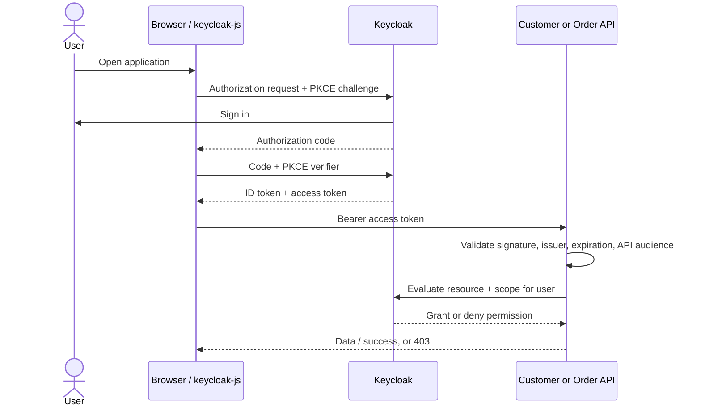

# Keycloak + Quarkus commerce authorization demo

A browser application signs in once with **OIDC Authorization Code + PKCE (S256)** and calls two independent Quarkus REST APIs. Keycloak Authorization Services decides which resource scopes each user receives. Both APIs use `quarkus-oidc` and `quarkus-keycloak-authorization`; no `@RolesAllowed` annotations duplicate the Keycloak policies.

## What you can demonstrate

| User                            | Customer inquiry | Order inquiry | Update order | Delete order |
| ------------------------------- | ---------------- | ------------- | ------------ | ------------ |
| Anonymous                       | 401              | 401           | 401          | 401          |
| Alice (`reader`)                | 200              | 200           | 403          | 403          |
| Bob (`reader`, `order-manager`) | 200              | 200           | 200          | 204          |

The frontend deliberately leaves update/delete buttons available to Alice. The API returns a real **403**; hiding buttons is not the security boundary.



## Repository layout

- `customer-api/`: read-only customer REST API, Java 21 / Quarkus 3.40.1.2.
- `order-api/`: order inquiry, status updates and deletion.
- `frontend/`: vanilla JavaScript, Vite, `keycloak-js` 26.2.4; tokens remain in memory.
- `keycloak/realm.json`: complete import for Keycloak 26.8.2, including users, public clients, API clients, audiences, resources, scopes, role policies and permissions.
- `scripts/`: local run helper, OpenShift manifest renderer and installer.
- `openshift/`: deployment overview; generated manifests go into ignored `.runtime/`.
- `postman/`: importable collection and local environment.
- `tests/smoke.py`: real login / PKCE / API permission tests using Python's standard library.
- `docs/`: setup details, policy exercise, Postman and deployment instructions.

## Run locally

Prerequisites: Java 21, Maven 3.9+, Node.js 22.12+ (or Node 24), Python 3.10+, and Docker Compose or Podman Compose.

1. Start Keycloak:

   ```sh
   docker compose up -d
   # Alternative: podman compose up -d
   ```

2. Wait until [Keycloak](http://localhost:8080) responds, then build and start the APIs and frontend:

   ```sh
   ./scripts/dev.sh
   ```

3. Open [the application](http://localhost:5173). Use `localhost` consistently; `127.0.0.1` is a different redirect origin.

   | Account | Local password |
   |---|---|
   | `alice` | `alice-demo-password` |
   | `bob` | `bob-demo-password` |
   | Keycloak administrator `admin` | `admin-demo-password` |

4. As Alice, load customers and orders, then try updating/deleting an order: expect **403**. Sign out, sign in as Bob, update `O100`, then delete `O200`: expect **200** and **204**.

5. Restart the Order API to restore its two sample records. Run integration tests against fresh data:

   ```sh
   python3 tests/smoke.py
   ```

The tests perform real Authorization Code + PKCE logins through Keycloak's supplied login form. Password grants remain disabled. They intentionally delete `O200`; restart Order API before rerunning or before running the Postman collection.

If containers are unavailable, download Keycloak 26.8.2 from the official distribution, copy `keycloak/realm.json` into its `data/import/` directory, and run:

```sh
KC_BOOTSTRAP_ADMIN_USERNAME=admin KC_BOOTSTRAP_ADMIN_PASSWORD=admin-demo-password \
  /path/to/keycloak/bin/kc.sh start-dev --import-realm --http-port=8080
```

## Deploy to OpenShift

After `oc login`, supply a fresh namespace and your cluster's application domain:

```sh
./scripts/deploy-openshift.sh commerce-demo apps.cluster.example.com
```

The installer compiles the APIs, renders configuration and Secrets, runs binary Docker builds in OpenShift, and waits for rollouts. No external image registry account or GitHub repository is needed. Generated URLs and random passwords are saved in `.runtime/commerce-demo/demo-login.json` (mode 0600, ignored by Git).

To reuse an existing Keycloak server, pass its HTTPS URL as the third argument and supply `KC_ADMIN_USER` / `KC_ADMIN_PASSWORD` to the installer. It creates a separate `commerce-demo` realm and omits the bundled Keycloak workload.

See [OpenShift instructions](docs/openshift.md) for cluster prerequisites and the demo's persistence limitations. See [Postman instructions](docs/postman.md) to test the same behavior without the frontend.

## Token Inspector

After login, the frontend's **Token Inspector** displays access, ID and refresh token cards. Expand **Decoded claims** to examine the payload, including API audiences, realm roles, scopes and expiry where present. Each card has a live expiration countdown and an explicit reveal/hide button for its raw token. Raw values start hidden and are hidden again after token refresh.

Use **Refresh tokens now** to force the adapter to obtain fresh tokens and observe the updated claims/expiry. API calls also refresh tokens when necessary. Tokens stay in browser memory; the inspector does not persist or log them. Treat revealed tokens as credentials and hide them before screen sharing. Decoding claims is informational and does not replace server-side signature validation or Keycloak authorization.

## Endpoints

| Service | Endpoint | Scope |
|---|---|---|
| Customer API | `GET /api/customers` | `read` |
| Customer API | `GET /api/customers/{id}` | `read` |
| Order API | `GET /api/orders` | `read` |
| Order API | `GET /api/orders/{id}` | `read` |
| Order API | `PUT /api/orders/{id}` body `{"status":"SHIPPED"}` | `update` |
| Order API | `DELETE /api/orders/{id}` | `delete` |

Supported statuses: `NEW`, `PROCESSING`, `SHIPPED`, `CANCELLED`. Missing records return 404; malformed/invalid update bodies return 400. Health checks are public under `/q/health/`.

## How authorization is configured

`commerce-web` and `commerce-postman` are public clients with PKCE required and implicit/password grants disabled. Both include `customer-api` and `order-api` in the access token audience; each API explicitly validates its own audience. ID tokens are not accepted as API credentials.

Each API is a confidential resource-server client. Its secret is used server-side by the policy enforcer; it is never supplied to browser JavaScript or Postman. Resources cover both collection and item paths. HTTP methods map to scopes in each API's `application.properties`.

The realm's `Readers` role policy grants `read` to users with `reader`. The Order API's `Order managers` policy grants `update` and `delete` to `order-manager`. Remote resource management is enabled so the authenticated policy enforcer can retrieve resource metadata through the Protection API. There is **no default allow-all policy**. See [the live policy-change exercise](docs/authorization-demo.md) to change authorization without rebuilding an API.

## Demo boundaries

Sample customers and orders are shared across authenticated readers; this demonstrates action permissions, not customer ownership or tenant isolation. Orders are in memory, with one replica, and reset on process restart. Local credentials are deliberately public demo credentials. OpenShift generates new passwords and secrets, but its Keycloak database uses ephemeral storage and reimports the realm after pod replacement. For a durable environment use the Keycloak Operator with a supported external database, backups, trusted certificates and managed secrets. See [deployment notes](docs/openshift.md).

## References

- [Quarkus: centralize authorization with Keycloak](https://quarkus.io/guides/security-keycloak-authorization)
- [Keycloak Authorization Services](https://www.keycloak.org/docs/latest/authorization_services/index.html)
- [Keycloak JavaScript adapter](https://www.keycloak.org/securing-apps/javascript-adapter)
- [Keycloak container deployment](https://www.keycloak.org/server/containers)

Run the included GitHub Actions workflow to build the applications and test PKCE and API permissions against a fresh local Keycloak instance.

See [the customer demo script](docs/customer-demo-script.txt) for a high-level walkthrough.

## Configuration privacy

All published hostnames are localhost or example placeholders. The Alice, Bob and admin credentials and API secrets in local configuration are intentionally public demo values, not credentials for an existing environment. OpenShift deployment generates fresh credentials in ignored `.runtime/` files. Never commit generated manifests, tokens, credentials, screenshots of live sessions, or cluster certificates.
